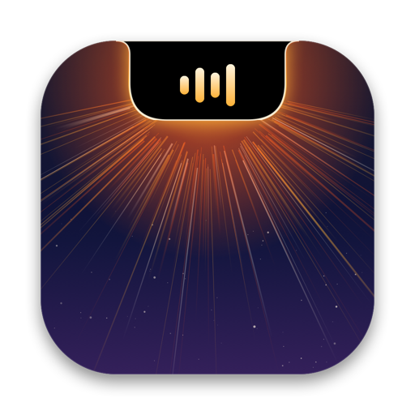
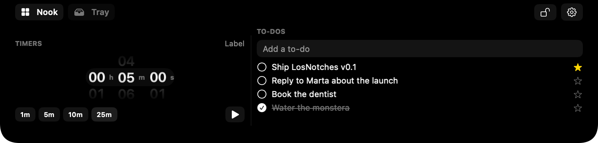

<p align="center">
  
</p>

<h1 align="center">LosNotches</h1>

<p align="center">
  Your MacBook's notch has been dead space since 2021. LosNotches puts it to work.<br>
  Free, open source, and it never talks to the internet.
</p>

<p align="center">
  
</p>

---

Hover over the notch and click it. A panel slides out of it, and that panel is the **Nook**. It holds whatever
widgets you pick: what's playing, your next meeting, a quick note, a timer, the files you're juggling. Move the
pointer away and it tucks itself back into the notch.

While the Nook is closed, the notch still shows small **live activities** on either side of the camera. You see
album art while music plays, a countdown while a timer runs, and a glow when you plug in the charger. Hover one to
peek at the details. Swipe up to dismiss it.

Macs without a notch get a slim handle at the top of the screen that opens the same Nook. You can also have it draw
a fake notch.

## What's in the Nook

- **Now Playing**: Spotify, Apple Music, browsers, podcasts, anything macOS shows as Now Playing. Album art, a
  scrubber you can drag, and a switcher for when two apps are playing at once. Swipe sideways on the notch to skip
  tracks.
- **Calendar**: today and the days around it. Meetings with a Zoom, Google Meet, Teams or Webex link get a
  one-click Join button. Click an event to open it in Calendar.
- **Notes**: as many notes as you like, with bold, italic and underline. A code mode switches to monospace.
- **To-dos**: star the important ones. Done items tidy themselves away after a day.
- **Timers**: spin the wheels or tap a preset, then name the timer if you want. Several can run at once, and
  they keep counting through a restart.
- **Tray**: drag files onto the notch to park them there, or drop them on AirDrop to send them. Hold ⌥ to move
  instead of reference. Images, links and text from your browser work too, and ⌘V pastes.
- **Mirror**: a quick look at yourself before a call. The camera runs only while the Mirror is on screen.
- **Shortcuts and Quick Apps**: your favourite Shortcuts and apps, one click away.

## Live activities

Media, volume and brightness, battery (plugged in, unplugged, full, low), Bluetooth devices connecting,
upcoming meetings, running timers, and files in the tray. Each one can be switched off, and you choose which ones
may still show over fullscreen apps.

**Volume & brightness HUD.** LosNotches can replace the big grey macOS volume and brightness overlay with a slim
bar in the notch. It's off by default, because it needs the Accessibility permission to catch the keys.

## Make it yours

The **Appearance** settings let you change the island's corner radii and how its edges flare into the bezel.
You can give it a coloured border, turn the open Nook into blurred glass, and style every widget as a card with
its own radius, fill and outline. Widgets can be reordered and resized on a 12-cell grid. Media can show waves,
a spectrograph, pulsing circles, or nothing.

## Install

Grab `LosNotches-<version>.zip` from [Releases](../../releases), unzip it, and drag **LosNotches.app** into
Applications.

The app isn't notarized, so macOS blocks it the first time you open it. Right-click it and choose **Open**, or
go to **System Settings → Privacy & Security** and click **Open Anyway**. You only have to do this once.

Requires macOS 14.6 or later. Runs on Apple silicon and Intel.

## Permissions

LosNotches asks only for what each feature needs, and you can skip any of them. The feature just stays off.

| Permission | Why |
|---|---|
| Calendar | To show your events and meeting reminders. |
| Camera | For the Mirror widget. It's never on unless the Mirror is visible. |
| Bluetooth | To show when headphones, mice and keyboards connect. |
| System audio recording | So the waves, spectrograph and circle move with how loud your music actually is. Only the loudness is read; nothing is recorded. Decline it and the effects just animate on their own. |
| Automation | To control Music and Spotify directly. macOS asks the first time either app is open. |
| Accessibility | Only for the volume & brightness HUD replacement, which is off by default. |

It doesn't need Screen Recording, Full Disk Access or Input Monitoring. There's no account, no analytics and no
network access. Your notes, to-dos, timers and tray live in `~/Library/Application Support/LosNotches` and
nowhere else.

## Build it yourself

You need Xcode or just the Command Line Tools (`xcode-select --install`). There are no package dependencies.

```bash
git clone https://github.com/yegorglz/LosNotches.git
```

```bash
cd LosNotches
```

```bash
scripts/run.sh
```

| Command | What it does |
|---|---|
| `scripts/run.sh` | Debug build, then launch |
| `scripts/test.sh` | Run the unit tests |
| `scripts/build-app.sh release` | Universal `build/LosNotches.app` plus a zip for Releases |
| `scripts/icon/make-icns.sh` | Re-render the app icon from `scripts/icon/render-icon.swift` |

**Keep your permissions between builds.** macOS remembers permissions per code signature, and local builds are
signed ad hoc, so every rebuild forgets Accessibility, Camera and the rest. To avoid that, create a self-signed
code-signing certificate called "LosNotches Dev" (Keychain Access → Certificate Assistant → Create a
Certificate, type *Code Signing*), then build with:

```bash
LOSNOTCHES_SIGN_ID="LosNotches Dev" scripts/build-app.sh release
```

## How it works

The app is two Swift targets.

- **`NookCore`** holds every decision that can be tested without a screen: notch geometry, the open/close state
  machine, which live activity wins, the media stream decoder, file stores, calendar rules, battery transitions.
  It has 150+ unit tests.
- **`LosNotches`** is the AppKit and SwiftUI app around it. It has one borderless panel per display, plus the
  system integrations.

A few parts are less obvious:

- **Now Playing.** Since macOS 15.4, apps can't read Now Playing info directly. LosNotches bundles
  [mediaremote-adapter](https://github.com/ungive/mediaremote-adapter), which runs through the system's own
  `/usr/bin/perl`, the same approach other notch apps use.
- **Staying in place.** The island sits in its own private window space above every desktop. That keeps it
  welded to the notch while you swipe between Spaces instead of sliding along with them.
- **The HUD.** While the replacement is on, LosNotches pauses the system's `OSDUIHelper`. It always resumes it
  when you quit, and again at the next launch if the app ever crashed.

## Known limits

- Brightness keys control the built-in display only.
- Some of this was built on private macOS APIs (Now Playing, display brightness, the window space). A future
  macOS update could break them. When that happens LosNotches falls back gracefully, but the feature stops working.

## Uninstall

Quit LosNotches from its menu bar icon, then drag the app to the Trash. To remove its data and permissions as
well:

```bash
rm -rf ~/Library/Application\ Support/LosNotches
```

```bash
defaults delete dev.losnotches.LosNotches
```

```bash
tccutil reset All dev.losnotches.LosNotches
```

## Credits

Now Playing support comes from [mediaremote-adapter](https://github.com/ungive/mediaremote-adapter) by Jonas van
den Berg and contributors (BSD-3-Clause, see `Vendor/mediaremote-adapter/LICENSE`). The private-space technique
was learned from [boring.notch](https://github.com/TheBoredTeam/boring.notch).

## License

[MIT](LICENSE)
